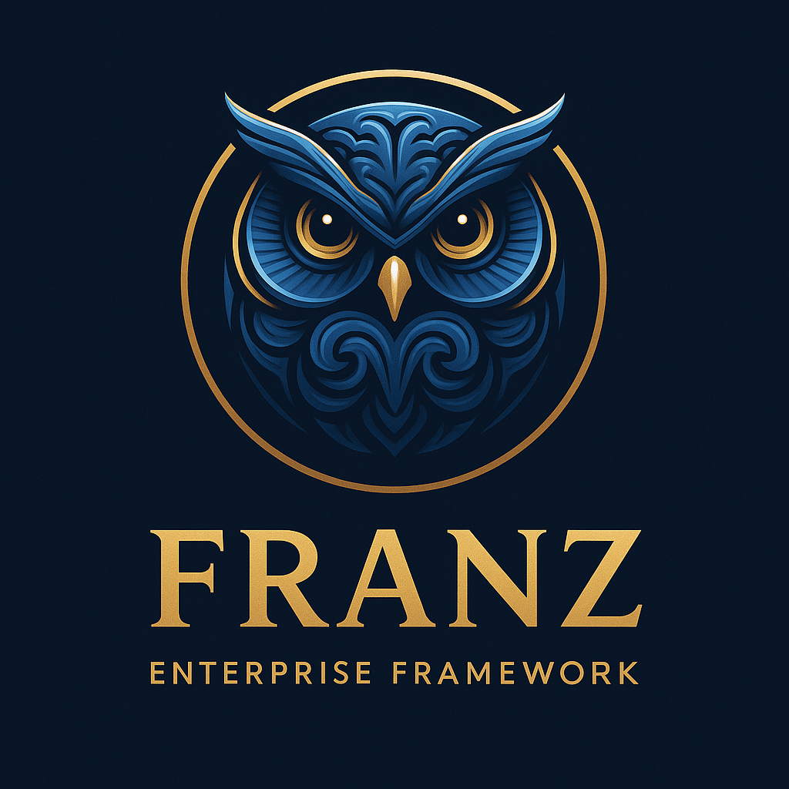
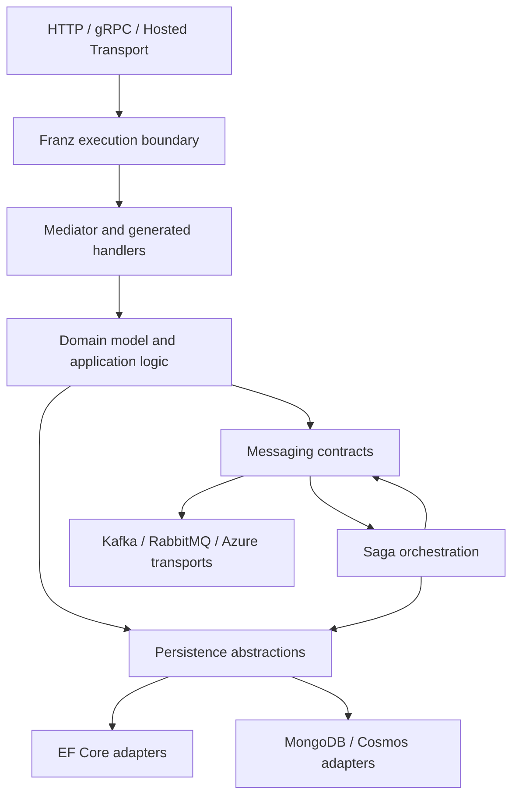

# Franz.Common

**An architecture and execution foundation for long-lived, event-driven .NET systems.**

[](https://dotnet.microsoft.com)
[](https://learn.microsoft.com/en-us/dotnet/core/deploying/native-aot/)
[](https://github.com/bestacio89/Franz.Common)
[](https://github.com/bestacio89/Franz.Common)
[](https://github.com/bestacio89/Franz.Common)
[](LICENSE.MD)

---

## What is Franz?

Franz.Common is the shared foundation of the Franz .NET framework. It provides reusable domain, application, infrastructure and transport capabilities while making important architectural boundaries explicit and testable.

The framework brings together:

- **Domain modelling:** entities, aggregate roots, domain events, factories and value objects.
- **Application execution:** CQRS mediator, generated handler registration and composable pipelines.
- **Messaging:** broker-neutral envelopes, Kafka and RabbitMQ integrations, Azure transports, inbox/outbox contracts and Saga orchestration.
- **Persistence:** EF Core relational adapters, MongoDB and Azure Cosmos DB integrations.
- **Cross-cutting capabilities:** validated multi-tenancy, identity, HTTP composition, gRPC, caching, resilience, logging and observability.
- **Architecture governance:** automated dependency rules, runtime-contract tests, provider integration tests and explicit exception tracking.

Franz is modular. Applications reference the packages for the capabilities and infrastructure providers they actually use.

## Package families

The repository contains independently packaged components. The following groups describe the principal responsibilities; the source tree and each package README remain the authoritative package inventory and API guide.

| Area | Representative packages | Responsibility |
|---|---|---|
| Core and composition | `Franz.Common`, `Franz.Common.DependencyInjection`, `Franz.Common.Serialization`, `Franz.Common.Hosting` | Shared primitives, registration, serialization and host integration |
| Domain and application | `Franz.Common.Business`, `Franz.Common.Mediator`, `Franz.Common.Mediator.SourceGenerator` | DDD contracts, factories, dispatch and generated registrations |
| Messaging | `Franz.Common.Messaging`, `Franz.Common.Messaging.Hosting`, `Franz.Common.Messaging.Kafka`, `Franz.Common.Messaging.RabbitMQ` | Broker-neutral message contracts, transport integrations and hosted listeners |
| Saga orchestration | `Franz.Common.Messaging.Sagas` | Saga lifecycle, inbound event handling, retries, audit and persistence adapters |
| Persistence | `Franz.Common.EntityFramework`, provider-specific EF packages, `Franz.Common.MongoDB`, `Franz.Common.AzureCosmosDB` | Relational and document persistence integrations |
| HTTP and RPC | `Franz.Common.Http.*`, `Franz.Common.Grpc`, `Franz.Common.Grpc.AspNetCore` | HTTP pipeline, clients, identity, multi-tenancy and gRPC boundaries |
| Platform services | `Franz.Common.Caching`, `Franz.Common.MultiTenancy`, `Franz.Common.Identity`, `Franz.Common.SSO`, `Franz.Common.Logging` | Caching, tenant context, identity and operational concerns |
| Testing | `Franz.Common.Testing` | Reusable test support outside production runtime packages |

See the [sources directory](sources/) and the README shipped with each package for its exact public surface, registration model, dependencies and limitations.

## Architecture at a glance



The domain and application layers depend on contracts rather than broker or database clients. Provider-specific behavior remains in its adapter package; guarantees are documented at the boundary where they can actually be enforced.

## Messaging and Saga orchestration

The messaging packages separate transport-neutral contracts from broker clients and hosted listeners. Message envelopes carry stable message identity, correlation and causation metadata. Inbox/outbox stores provide the persistence contracts used by supported adapters.

The Saga package builds on those contracts to provide:

- Explicit Saga identity resolution and mutually exclusive start, step and compensation roles.
- Lifecycle-gated orchestration with optimistic concurrency.
- Inbound integration-event notification handlers registered from Saga message contracts.
- Atomic inbox receipt, Saga state transition and outgoing outbox persistence when using a supported transactional adapter.
- Durable delayed retries through persisted retry state and the outbox.
- Metadata-only audit records and bounded retention for supported durable providers.
- In-memory, EF Core, MongoDB and Cosmos persistence options, with provider-specific transactional boundaries.

**Delivery guarantee:** database state and outbox records can be committed atomically within the supported provider boundary. Broker publication remains at-least-once; a publish followed by a process crash before completion can result in redelivery. Consumers and external side effects must be idempotent. Franz does not claim exactly-once effects across a database and broker.

The in-memory Saga adapter is intended for development and tests; it does not provide durable inbox/outbox or retry guarantees. MongoDB transactions require a transaction-capable deployment. Cosmos transactional operations are limited to the documented shared logical partition/container boundary. EF Core hosts must apply the migrations required by the Saga schema before enabling the corresponding features.

Start with the [Saga package guide](sources/Franz.Common.Messaging.Sagas/readme.md), which documents registration, message identity, lifecycle transitions, retry/recovery, transaction boundaries, delivery semantics and provider limitations.

## Native AOT and trimming

Franz treats Native AOT as a package- and API-specific compatibility contract, not a blanket property inferred from a successful publish of one application.

The current CI publishes and executes Native AOT smoke consumers for the following paths:

| Package area | Validated path | Important boundary |
|---|---|---|
| Framework and messaging | Generated mediator registration and source-generated message JSON metadata | Application message types must be included in the generated JSON context; use the generated registration path |
| Business | Entity and aggregate factories, enumeration lookup and generated business-handler registration | Optional platform pipeline integrations are outside this smoke contract |
| Dependency injection | Explicit generic service registrations | Scrutor/assembly-scanning APIs are marked as requiring unreferenced code and remain intended for JIT applications |
| Serialization | Source-generated `JsonSerializerContext`, generic/runtime serializer operations and explicit enumeration converters | Reflection-based converter factories are not the AOT path |

For serialization, register metadata for every root and concrete runtime type that may be serialized or deserialized. Missing metadata fails explicitly rather than silently falling back to reflection. For DI, prefer explicit registrations in AOT applications; do not suppress trimming warnings around runtime assembly discovery.

A package smoke test is evidence for the exercised package path. It does not certify every API, optional integration, third-party provider or complete application dependency graph. In particular, qualify provider and hosting dependencies independently before making an application-wide Native AOT claim.

## Multi-tenancy and security boundaries

Tenant identity is represented by a validated execution context and propagated through supported HTTP, messaging and persistence paths. Framework-managed relational EF Core operations enforce tenant filters and ownership rules where the documented contracts apply. Messaging derives outbound tenant metadata from validated context rather than treating caller-supplied headers as authority.

These controls do not automatically secure arbitrary raw SQL, stored procedures, direct database connections, provider-native bulk APIs, deliberate query-filter bypasses or external side effects. Applications must explicitly secure those paths and apply database-level controls where required. MongoDB and Cosmos DB use provider-native tenant contracts; do not infer relational EF Core guarantees for document stores.

See the tenant and provider-specific documentation under [Docs](Docs/) and the individual package READMEs for tested scope and limitations.

## Architecture governance

The framework's architecture tests validate Franz.Common itself. They enforce package dependency direction, keep test-only dependencies out of runtime packages, inspect selected runtime patterns, and verify domain and runtime contracts. Existing exceptions are explicit and reasoned; new violations fail validation.

The application-level **Franz Architectural Tribunal** is maintained separately in the [Franz template repository](https://github.com/bestacio89/Franz). It validates applications built on the framework and is not a substitute for this repository's framework architecture tests.

## Getting started

Install the packages your application needs. For example:

```bash
dotnet add package Franz.Common
dotnet add package Franz.Common.Business
dotnet add package Franz.Common.Mediator
dotnet add package Franz.Common.Messaging
```

A minimal composition depends on the packages and features selected by the application. A generated Mediator registration, for example, is configured from the application assembly:

```csharp
using Franz.Common.Mediator.Extensions;

builder.Services.AddFranzMediator(new[] { typeof(Program).Assembly });
```

For Business registration:

```csharp
using Franz.Common.Business.Extensions;

builder.Services.AddBusiness(typeof(Program).Assembly);
```

For Saga orchestration, see the complete provider-specific registration examples in the [Saga README](sources/Franz.Common.Messaging.Sagas/readme.md). Do not copy a generic sample without configuring the selected persistence provider, migrations/containers and outbox worker.

The shared build target currently sets package, assembly and file versions to **3.0.0**. Package publication is a separate release operation and is not implied by a successful repository build or merge.

## Build and test

Requirements:

- .NET SDK 10.0.403 (see [global.json](global.json)).
- Python 3 for the test-suite runner and repository validation scripts.
- Docker-compatible container runtime for the integration suites that use Testcontainers.
- Provider-specific local infrastructure only where a test suite explicitly requires it.

Build the solution:

```bash
dotnet restore Franz.Common.slnx
dotnet build Franz.Common.slnx --configuration Release --no-restore
```

The repository's test manifest assigns every test project to exactly one suite. Validate ownership and run suites independently:

```bash
python3 scripts/run-test-suite.py
python3 scripts/run-test-suite.py core --configuration Release
python3 scripts/run-test-suite.py messaging --configuration Release
python3 scripts/run-test-suite.py database --configuration Release
python3 scripts/run-test-suite.py integration --configuration Release
```

The runner builds projects serially to avoid overlapping MSBuild writes in the shared workspace, then applies the concurrency and isolation rules declared by the manifest. Cosmos emulator tests are isolated from the regular project test batch.

### Pull-request CI

The GitHub workflow deliberately separates validation into independent jobs:

- Build, package, package-consumer checks, vulnerability audit and architecture tests.
- Package-specific Native AOT publish-and-execute smoke tests.
- Core framework tests.
- Messaging transports and Saga tests.
- Database provider tests.
- Cross-cutting integration tests.

This is a suite-based pipeline, not one monolithic test command with a short global timeout. Each suite has its own timeout, logs and test-result artifacts. The test-suite manifest is checked for exact ownership so that adding a test project without assigning it to CI fails validation.

### Caching performance validation

Caching changes have additional performance validation:

- BenchmarkDotNet microbenchmarks measure isolated provider operations, deterministic key generation, payload-size sensitivity and concurrent access. See [the benchmark methodology](benchmarks/Franz.Common.Caching.Benchmarks/README.md).
- A production-style workload runner exercises MemoryCache, Redis-backed DistributedCache, HybridCache with Redis L2 and direct Redis. It models multi-tenant access, hot-key skew, mixed payloads, warm-up, ramp-up, sustained concurrency and ramp-down. See [the workload methodology and profiles](benchmarks/Franz.Common.Caching.LoadTests/README.md).

CI publishes machine-readable and human-readable reports. Absolute performance thresholds remain disabled on variable hosted runners until controlled-runner baselines are established.

## Versioning and release notes

All framework packages share the coordinated version defined in [common.targets](common.targets). The current 3.0.0 work is a coordinated platform update; package publication remains gated on full Release validation, API compatibility review and explicit release approval.

See [changelog.md](changelog.md) for the detailed history, migration notes and release boundaries. A changelog entry does not by itself mean that packages have been published to NuGet.

## Contributing

Changes should include focused tests, package documentation and release notes where public behavior or contracts change. Preserve package boundaries, cancellation and disposal semantics, tenant isolation, provider-specific guarantees and the repository's architecture rules.

Run the relevant test suite locally before opening a pull request. New test projects must be assigned in [scripts/test-suites.json](scripts/test-suites.json). Runtime packages must not acquire test-only dependencies.

## License

MIT. See [LICENSE.MD](LICENSE.MD).
